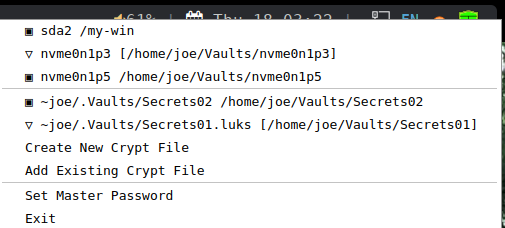

# LUKS Tray

**luks-tray** is a QT-based tray utility for managing ad hoc LUKS-encrypted files: mount and unmount with ease from your Linux desktop environment. Legacy TrueCrypt/VeraCrypt *file* containers can be added and managed the same way -- see [Limitations](#limitations) for exactly how far that goes.

Version 3.0.0 (v3) added and enhanced features and improved quality.

## Features

- **System tray integration** - Simple click-to-mount/unmount interface for LUKS devices and files
- **Visual status indicators** - Symbols mounted (▣), mounted read-only (⧈), unmounted (▽), and open-but-unmounted (‼) states
- **Options dialog** - `⚙ Options…` edits the settings below, and the entry directly below it — `✎ Create Master Password…`, later `✎ Update Master Password…` — sets, changes or clears the master password; the fixed entries carry a symbol too (`✦` create, `✚` add, `⚙` options, `✎` master password, `☓` exit, `↺` restart) [**added in v3**]
- **File container support** - Add, create, and manage LUKS file containers from the tray.
- **TrueCrypt/VeraCrypt file containers** - `✚ Add Existing Crypt File` also opens a legacy TrueCrypt or VeraCrypt container. Which header it has is worked out from `cryptsetup`'s answer rather than asked for, the history keys such an entry by its header salt (there is no readable UUID), and the next unlock asks for the type that worked [**added in v3**]
- **Mount point history** - Remembers previous mount locations for convenience and clarity
- **Background monitoring** - Automatically detects newly inserted devices with LUKS containers
- **Password management** - Optional master password to encrypt stored credentials
- **Single instance** - A second copy refuses to start (exit status 3) instead of racing the running one; `--replace` terminates the holder and takes over [**added in v3**]
- **Restart from the menu** - The bottom menu entry reads `↺ Restart luks-tray v<version>`, so the running build is visible without leaving the menu [**added in v3**]
- **A log that explains itself** - `≡ Open Log` pages `debug.log` live, and the entry becomes `≡ Open Log [n errors]` once *this session* has reported a failure, so a dialog that says what failed is one click away from the log that says why. The log starts with a `=== luks-tray v<version> started, pid <pid> ===` line and ends with the matching one [**added in v3**]
- **Late or restarting panels** - If the bar starts after the applet, or restarts later, the tray icon registers itself with it instead of staying invisible until the applet is restarted [**improved in v3**]
- **Wayland dialog support** - On niri, sway and the other tiling compositors a dialog is a client, so the compositor decides its size and placement. Every dialog therefore carries one stable `app-id` (`luks-tray`), which a single window rule can match to make the dialogs float, and `--show-window-rules` prints the rule for the current session to paste into the compositor's config. Because sway hides title bars, each dialog also repeats its purpose as a heading inside the dialog itself, so nothing depends on the title bar being visible. See [Wayland tiling compositors](#wayland-tiling-compositors-niri-sway) [**improved in v3**]
- **Start at login** - The `--svc-*` verbs write, render, enable and manage a `systemd --user` unit for the session. See [Starting at Login](#starting-at-login) [**added in v3**]

## Competitive Analysis (as of November 2026)

This tool exists because of a specific mismatch, and the date in this heading is
there because competitor GUIs change. The VeraCrypt GUI was the model: a list of
containers *you* own, each with a mount point *you* chose, all of it one click
from the tray. The Linux options at the time were either whole-disk tools that
happened to accept a file, or GUIs that covered only one container type and
remembered nothing -- so keeping a handful of file containers in rotation meant
re-entering a passphrase and a path every time, and no single place ever showed
what was open.

The use-case this applet is written for: **many ad hoc encrypted file
containers, mounted and unmounted often, on a desktop or tiling WM that gives
per-container state nowhere else.** Judged against that, the alternatives fall
into four groups. This is not a benchmark; it is what the author compared, and
what each group still can and cannot do. Corrections are welcome as issues.

| Group | Examples | Strong at | Stops where it matters here |
| --- | --- | --- | --- |
| **Desktop file managers and auto-mount** | GNOME Files (Nautilus), Dolphin, Thunar, PCManFM, GNOME Disks -- all on udisks2 | Everything a desktop is expected to do: removable media, whole disks, system partitions; a LUKS partition is usually one click and one passphrase prompt, and some will loop-mount a LUKS image too | The passphrase is prompted per mount, never remembered for an ad-hoc container; the mount point is udisks2's choice under `/media/…` or `/run/media/…` and is not remembered per container; a container that is *opened but not mounted* looks like nothing at all; and TrueCrypt/VeraCrypt file containers are outside the model entirely. It is also a file manager, not a posture indicator: you learn the state of your vaults by browsing |
| **VeraCrypt's own GUI** | VeraCrypt (TrueCrypt's successor; TrueCrypt mode for old volumes) | The closest thing to this tool's workflow, and its direct inspiration: favourites that pin a mount point, a tray presence, container creation | VeraCrypt volumes (and TrueCrypt ones in TrueCrypt mode) only -- a LUKS container cannot be opened at all, as far as this author knows. It also carries no master password of its own, so it can remember *where* a container mounts but not *how to open* it, and it is not packaged by most distros, so it arrives out of band |
| **`cryptsetup` front-ends** | zuluCrypt/zuluMount, cryptmount, plain `cryptsetup` in a terminal | zuluCrypt is the closest open-source match on format coverage: LUKS, TrueCrypt and VeraCrypt in one GUI, with a volume list | No master password over the stored entries, no per-container mount-point history in the form this tool uses, and no overall posture in the tray. The CLI tools it wraps are excellent and fully scriptable -- which is exactly why this applet calls them, rather than replacing them |
| **Transparent folder encryption** | Plasma Vault, GNOME Vaults, Cryptomator (gocryptfs/cryfs underneath) | A folder that is simply *there* once unlocked, with no mount step to forget | A different problem: these encrypt a directory in place, usually through FUSE, and are not a single container file you can copy, move, hand to another machine, or open with plain `cryptsetup` elsewhere. For "my documents directory is encrypted" they are the better answer |

What is left, and why this tool is not redundant:

- **A master password over the history.** The history file stores passphrases
  *and* mount preferences under one master password, entered once per session
  (or not stored at all, if you set none). A file manager never stores a
  container passphrase and VeraCrypt's GUI stores no secret at all, so this is
  the feature that most distinguishes the tool -- and it is deliberately a
  *single* file you can delete to revoke everything.
- **Mount points are pinned and remembered.** Each container carries its last
  mount point, the default root is a single configurable, validated
  `auto_mount_folder` (`~/Vaults`), and both are visible in the dialog before
  the mount happens. VeraCrypt favourites do the same for VeraCrypt files; no
  file manager does it for a LUKS container.
- **State, not just availability.** The shield colour is a posture: locked,
  mounted, read-only, and the `‼` case of *opened but not mounted* -- a volume
  whose passphrase succeeded and whose filesystem did not get mounted, which is
  both leaked and lost. A file manager has no place to report that.
- **One list, one set of verbs.** A discovered LUKS partition, a LUKS file and a
  legacy TrueCrypt/VeraCrypt file appear side by side and are mounted,
  unmounted and inspected by the same two clicks. zuluCrypt is the only other
  entry above that spans those formats.
- **No daemon and no root GUI.** It is a tray process plus narrowly scoped
  `sudo` rules (see [Requirements](#requirements)); the privileged work is the
  same `cryptsetup`/`mount`/`umount` a shell would run, with no udisks2 policy
  in between and no privilege boundary to learn.

Where a different tool is the right answer: whole-disk and `/home` encryption
(the file managers, `systemd-cryptsetup`, or your distro's installer); hidden or
system VeraCrypt volumes, or a non-default PIM (VeraCrypt itself -- see
[Limitations](#limitations)); a directory that should simply be encrypted all
the time (the folder-encryption tools); and anything scripted or headless
(`cryptsetup` directly).
This is also a one-author project without a security audit or distro packages,
which is a real difference from every group above -- judge it accordingly.

## Quick Start

1. Install `luks-tray`  using `pipx`; e.g. `pipx install luks-tray`. See [pipx docs](https://pypa.github.io/pipx/).
2. Setup passwordless `sudo` if not already (see notes below if needed).
3. From a terminal:
    - run `luks-tray --check-deps` and install any required commands.
    - run `luks-tray` to ensure it finds your system tray and appears.
4. Right-click the tray icon to see available containers. You may:
    - Insert a disk with LUKS devices to detect them automatically.
    - Add an existing or create a new encrypted file to manage it.
    - Open `⚙ Options…` to change the settings below, or `✎ Create Master Password…` (later `✎ Update Master Password…`) to set, change or clear the master password.
5. Left-click a ▽ container to mount it; or a ▣ or ⧈ or ‼ container to unmount it.
6. When mounting a container, enter its password and choose mount point in the dialog
    - if the app has a mount point in its history, it will fill in that mount point
    - otherwise, the app will generate a mount point in `~/Vaults`
7. Finally, start it automatically at login -- `luks-tray --svc-install` on a
   systemd system, or your DE's autostart entry.  See [Starting at Login](#starting-at-login).

Only one copy can run at a time: a second launch reports the running instance and exits with status 3. Use `luks-tray --replace` to terminate it and take over, or the `↺ Restart luks-tray` entry at the bottom of the menu to restart it in place.

## Visual Interface

The tray icon is a shield, and its colour reports the state of the containers:
-  - All containers are locked and unmounted (i.e., all data is secure). This is only shown when the applet can actually see the containers.
-  - Some containers are unlocked but unmounted (i.e., one or more anomalies).
-  - Some containers are mounted w/o any anomalies (i.e., some of the encrypted data is available)
-  - The history file is encrypted and its master password has not been entered yet, so the containers cannot be inspected at all: the state is *unknown*, not "everything locked". Enter the password with the menu entry `✎ Click to enter master password`.

Here is an sample menu as seen when you right-click the tray shield icon:

</center>

Notes:

- the first section shows LUKS devices, and the second shows LUKS files.
- click a ▣ or ⧈ entry to dismount and lock a mounted, unlocked LUKS container

  - note that ▣ indicates full access; ⧈ indicates readonly
  - if busy, you are shown the PIDs and names of processes preventing dismount

- click a ▽ entry to unlock and mount a locked LUKS container
- click a ‼ entry to lock an unmounted, unlocked container (considered an anomaly)
- the fixed entries at the bottom carry a symbol: `✦` create a new crypt file, `✚` add an existing one, `⚙` options, `≡` open the log, `☓` exit, `↺` restart
- `≡ Open Log` only appears when it can work: the applet's own output *is* the log file, so `less` needs a terminal emulator to be started in. If none is found, set `log_viewer` in `config.ini` (see below).
- once this session has reported a failure, that entry reads `≡ Open Log [n errors]`; the count is of this session only, so a restart clears it, and the dialogs' own errors (a mount that did not happen, a viewer that would not start) are included, not only the ones that reached the file.
- while the history is locked the menu is short: `✎ Click to enter master password`, `≡ Open Log` when it can work, and the two entries that end every menu. Neither `⚙ Options…` nor the master-password entry is offered there: both dialogs write the history file from what is in memory, and a locked history has nothing in memory to write.
- while the history is unlocked, the restart entry reads `↺ Restart luks-tray v<version> (locks history)`: a restart is the manual way to lock without leaving, because the master password lives in memory only. The suffix is absent while the history is stored in clear text (there is no key) and while it is locked (there is nothing left to forget).
- LUKS devices must be created with other tools such as Gnome Disks.
- LUKS files are only automatically detected in its history; when you add or create new LUKS files, they are added to the history.
- A TrueCrypt/VeraCrypt file is managed like a LUKS file once added, except that it can never be *discovered*: its header is encrypted, so nothing can tell it apart from random data without the password. Add it once with `✚`, and the history carries it from then on.
- When creating LUKS files, the default folder is `~/.Vaults`.
- When mounting LUKS files for the first time, the default folder is `~/Vaults/{basename}` where `{basename}` is the basename of the encrypted LUKS file, less a known container suffix (`.luks`, `.luks2`, `.crypt`, `.img`): `~/.Vaults/test-only-tcrypt.img` is first offered `~/Vaults/test-only-tcrypt`.
- Keep the two folders apart: containers in `~/.Vaults`, mount points in `~/Vaults`. Only the suffixes above are dropped from a derived mount point, so a container named without one (`myvault.dat`) kept *under* `~/Vaults` is offered its own path as its first mount point, and that is refused with `mount point (...) exists but is not a directory`.


## Configuration

Settings and data files are stored in `~/.config/luks-tray/`:
- **History file** - Stored of passwords and mount preferences; it is encrypted when the master password enabled.
- **Lock file** - `luks-tray.lock` holds the PID of the running instance; the kernel releases the lock when that process exits, so a crash never blocks the next start.
- **Log file** - `debug.log` is where the applet writes everything it does (the command it ran, what it refused, with a timestamp and the code location). It is the destination whether a desktop, a systemd unit or a terminal started the applet: started from a terminal the lines are printed *and* mirrored into the file, so `≡ Open Log` shows that session as well; `luks-tray -o` is the opt-out that keeps them on the terminal only (a systemd unit ignores `-o`: there stdout is the unit's own). The file opens with `=== luks-tray v<version> started, pid <pid> ===` and closes with the matching `stopped` line — also after `systemctl --user stop` or `--replace`, which end the process with a signal — so a file holding several runs is still readable. It is created owner-only, since it names container paths and mount points, and at 512 KB it rotates to `debug.log.old` — one generation, which the viewer pages as its second file. Lines Qt itself produces arrive as `qt: …` with Qt's own `[file:line]`, each reported once, while a platform theme's chatter (the qt5ct/qt6ct palette dump) and Qt's `QThreadStorage … destroyed` shutdown notice are dropped. `luks-tray --follow-log` tails the file from a shell.
- **INI file** - the default .ini file looks like:

      [ui]
      show_passwords_by_default = True
      show_anomaly_alerts = True
      auto_mount_folder = ~/Vaults
      log_viewer =

  You can thus change
    - whether passwords are shown by default when being first entered.
    - whether ‼️ entries (i.e., anomalies) cause the tray icon to change to the alert shield.
    - where the automatically generated mount points live
    - which terminal to show the log in: `log_viewer` is a command prefix such as `foot -e` or `xterm -maximized -e`. Empty means "use the first terminal emulator found".

  The same four settings are in the tray menu under `⚙ Options…`. A *changed* `auto_mount_folder` is checked before saving: a path that is not a dedicated, absolute, user-owned folder is refused with the reason in a message box, instead of being quietly replaced by the default at mount time. The stored value is not re-checked, so saving an unrelated setting is never blocked by the folder the app created itself. The vault root and each mount point are created `0700` instead of inheriting the desktop's umask, and a group-writable root left by an older release is tightened to `0700` at start-up with a line in the log (a world-writable root is still refused). `log_viewer` is checked too — a command line that cannot be parsed would otherwise silently leave the menu without its `≡ Open Log` entry. Saving rewrites `config.ini` — settings this version does not know are kept, comments are not.

  The master password has a menu entry of its own, directly below `⚙ Options…`, and its wording is the state: `✎ Create Master Password…` while the history is stored in clear text, `✎ Update Master Password…` once it is encrypted and unlocked. Both open one dialog with two masked fields — *New master password* and *Repeat new password*, each with its own show/hide eye — and buttons that describe those fields rather than deciding for them: `Apply` (or `Change Password`) is enabled only when the two entries match and the password is at least 4 characters; `Clear Password` is enabled only when both entries are empty; `Cancel` is always available. Nothing else can be submitted — there is no Save button that has to interpret an empty pair, and no path from an empty field to a write. A new password is written, then read back with `verify_password_on_disk()`, and only then reported; both write paths leave the history **locked**, so the password is proved once by unlocking it. `Change Password` re-encrypts the file and keeps every remembered container password; `Clear Password` stores the file in clear text, where those passwords cannot be written, so it forgets them (see the security notes). The menu entry `✎ Click to enter master password` — the only password action while the history is locked — opens a separate dialog that can do exactly one thing: unlock, with a wrong password reported in a notice that closes itself.

## Security Notes

- Passwords are only stored when the master password feature is enabled
- The history file is encrypted with the master password: Fernet, keyed by PBKDF2-HMAC-SHA256 with a per-file salt and 600,000 iterations. Files written by older releases (unsalted key) still open and are rewritten in the salted form on the next save.
- The master password is never written anywhere — it is held in memory only — so restarting the applet locks the history again.
- The history also locks *while the applet is running*, as soon as the session stops being yours: the screen locking (`org.freedesktop.login1.Session`), the VT or user switching away (`Active` false), and the machine suspending (`PrepareForSleep`) each drop the master password **and** every container password it had decrypted from memory, so the menu shrinks to `✎ Click to enter master password` and the shield turns orange. All three are best effort — a session without logind (a bare window manager, a container) publishes none of them, and the applet writes one line to the log at start-up saying so. It deliberately does **not** lock on idle: an unlocked session left unattended is the one state these events cannot see, and by then the mounted containers have been exposed too (see below).
- **There is no recovery.** A forgotten master password cannot be reset, hinted, or derived from the file: the containers and the mount points the history was remembering are gone. The only escape hatch is to delete `~/.config/luks-tray/history.json`, which starts an empty, unencrypted history; the LUKS containers themselves are untouched, and devices are found again on the next scan (LUKS *files* have to be added again with `✚`).
- Changing or clearing the master password requires an **unlocked** history: both writes re-encrypt the file from what is in memory, and a locked history has nothing there. In that state the applet offers only `✎ Click to enter master password` and hides both settings entries, and [`HistoryClass.save()`](luks_tray/History.py) refuses any clear-text write over a file it could not read — so no click, and no stale window, can replace an encrypted history with an empty one.
- **Clearing the master password forgets the remembered container passwords.** A clear-text history is never written with a container password in it, so clearing drops them from the file; the running applet keeps using the ones it already holds until it exits. Changing the password does not: the file is re-encrypted, and every stored password survives.
- Both password dialogs clear their fields on the way out and keep the password nowhere but `HistoryClass.master_password`.
- The log file is owner-readable only, and never contains passwords or passphrases; it does record container paths and mount points
- System mount points are excluded by default to prevent interference with disk encryption
- When creating LUKS file containers, password strength is not enforced; use due care. The 4-character floor on the master password is a typo guard, not a strength requirement — a longer passphrase is still worth typing, since the file can be attacked offline.
- The master password protects the *history file*, not the mounted containers: an already unlocked and mounted container stays accessible to anyone at the session until it is locked again.

---
## Limitations

- **Not for whole disk encryption** - Designed for fixed and removable partition and file containers. Thus, excludes system mount points like `/`, `/home`, `/var` to avoid interfering with boot-time encrypted volumes.
- **No udisks2 integration** - Manages its own mount/unmount state. Mixing mounts/unmounts desktop auto-mounting tools may not produce the best results.
- **Loop device requirement** - LUKS file containers are found through their loop device, so `lsblk` must report one (standard on most distros). A TrueCrypt/VeraCrypt file has no loop device -- `cryptsetup` reads the file itself -- and is carried by the history instead.
- **TrueCrypt/VeraCrypt: add-only, default PIM** - These are supported for *legacy file containers*: they must be added by hand (no discovery, see above) and this applet never creates one. Only the default PIM (0) is used, so a container created with a non-default PIM is refused with the same message as a wrong password, and hidden or system (whole-disk) volumes are out of scope.
- **Single filesystem focus** - Containers with multiple filesystems are out of scope of this tool and get very limited support (i.e., mostly handling only the first filesystem).
---
## Requirements
#### Additional System Utilities may be Needed
This program requires `cryptsetup`, `fuser`, and other system utilities. After install, run `luks-tray --check-deps` to get a report on what dependencies are found and missing. If any are missing, install those using your distro package manager.

💡 The report searches `PATH`, so it prints the `PATH` it used whenever something is listed as missing: `cryptsetup`, `losetup`, `mkfs.ext4` and `blkid` live under `/usr/sbin` on Debian-style hosts, and a service manager that starts the applet with a `PATH` of only `/usr/bin:/bin` reports them as missing although they are installed. If `--check-deps` is clean in your shell but the log says `missing system commands`, the installed unit is the older one -- re-render it with `luks-tray --svc-install`.
#### Passwordless `sudo` Setup (Required)

The tray runs its privileged steps as `sudo -n …`, which never prompts. Grant passwordless access to the commands it actually needs -- not to `ALL` -- by running `sudo visudo` and adding (replacing `{yourusername}` with your actual username):

```
Cmnd_Alias LUKS_TRAY = /usr/bin/cryptsetup, /usr/bin/mount, /usr/bin/umount, \
                       /usr/bin/losetup, /usr/bin/fuser, \
                       /usr/bin/mkdir, /usr/bin/rmdir, /usr/bin/chown, \
                       /usr/bin/truncate, /usr/bin/mkfs.ext4, /usr/bin/bindfs

{yourusername} ALL=(ALL) NOPASSWD: LUKS_TRAY
```

💡 `sudo` matches the *resolved* command path, so confirm each entry on your distro with `command -v cryptsetup mount umount losetup fuser mkdir rmdir chown truncate mkfs.ext4 bindfs`, and correct any that live under `/usr/sbin` (common for `mkfs.ext4`). The rest of the `luks-tray --check-deps` list -- `lsblk`, `blkid`, `touch` -- runs unprivileged and needs no rule; `sudo` itself must of course be installed. See `man sudoers` for details.

#### A Working System Tray
It works best with DEs/WMs that offer **first-class tray support**, such as:

  - **KDE Plasma** (X11 or Wayland)
  - **i3wm** with **polybar**
  - **niri** with **waybar**
  - **sway** with **waybar** (see the compositor rule below for floating dialogs)

> ⚠️ **GNOME**: Requires a third-party extension (such as AppIndicator support) to show tray icons. Results may vary across GNOME versions.<br>
> ⚠️ **Xfce** and similar lightweight DEs: Tray menus may open off-screen or be partially cut off, depending on panel layout and screen resolution.


#### Wayland tiling compositors (niri, sway)

A Wayland compositor, not the app, decides where a window goes and whether it
floats. luks-tray therefore sets a stable Wayland `app_id` of `luks-tray` and
asks you to add the one rule your compositor needs. The same `app_id` covers the
mount/options dialogs, the error boxes and the file pickers.

Run this in the session you are configuring to print the matching snippet:

```sh
luks-tray --show-window-rules
```

**niri** -- add to `~/.config/niri/config.kdl`, then run
`niri msg action load-config-file`:

```kdl
window-rule {
    match app-id="luks-tray"
    open-floating true
}
```

**sway** -- add to `~/.config/sway/config`, then run `swaymsg reload`:

```
for_window [app_id="luks-tray"] floating enable, move position center, border normal
```

Do **not** add `no_focus`: the password dialogs need keyboard focus.

Sway hides title bars by default; niri and X11 draw them. Every luks-tray dialog
also shows the same purpose as a heading inside the dialog, so nothing depends
on the compositor drawing a title bar. Setting `XDG_CURRENT_DESKTOP` (or
`DESKTOP_SESSION`) lets `--show-window-rules` detect the compositor and keeps
the logged session banner identifiable.

---
## Starting at Login

luks-tray is a tray applet: something has to start it once your desktop session
exists. Pick the mechanism your session already uses, and use only one of them
-- two starts fight over the single-instance lock and the loser exits 3.

### A `systemd --user` unit (recommended on systemd distros)

Two units ship with the package, one per display server, and one command
installs the right one for the session it runs in:

```
luks-tray --svc-install     # write ~/.config/systemd/user/luks-tray.service and enable it
luks-tray --svc-status      # 0 = running, 1 = installed but not running, 2 = not installed
```

`--svc-install` renders the unit, reloads systemd and enables it -- it does
**not** start the applet, because you may already be running one from a desktop
autostart; the unit takes over at your next login. Use `--svc-start` to start it
now.

| Verb | What it does |
| --- | --- |
| `--svc` / `--svc-status` | Report the unit's state. Exit code 0 active, 1 installed but not running, 2 not installed, so it is usable from `if`. |
| `--svc-install` | Render the unit for this session, write it, reload, enable. The only verb that writes the unit file. |
| `--svc-start` | Start the installed unit now, and enable it if it was disabled. Never writes the unit. |
| `--svc-restart` | Restart it, so it runs the code `~/.local/bin/luks-tray` resolves to -- run this after `git pull` on an editable install. |
| `--svc-stop` | Stop it now. It stays enabled, so it returns at your next login. |
| `--svc-uninstall` | Stop, disable and delete the unit. Your config, history and logs stay. |
| `--show-svc-file` | Print the rendered unit and exit: a starter for a hand-installed or customised unit. |

The unit runs `~/.local/bin/luks-tray`, where `pipx` and `pip install --user`
both put it, so installing from a virtualenv writes the same file as installing
from any other shell. It also pins the session variables systemd cannot inherit
from the compositor -- `WAYLAND_DISPLAY` (or `DISPLAY`) and
`XDG_CURRENT_DESKTOP`/`DESKTOP_SESSION`, which Qt and the dialogs need -- filled
in from the shell that ran `--svc-install`. Run it from a terminal *inside* the
graphical session, not over `ssh`.

> ⚠️ If the tray only appears when you start it by hand, the user manager has no
> display for the unit. Add
> `dbus-update-activation-environment --systemd WAYLAND_DISPLAY XDG_CURRENT_DESKTOP`
> to your compositor's config (sway users usually already have it), then
> `luks-tray --svc-restart`.

#### Switching sessions

You do **not** have to re-run `--svc-install` when you log out of one display
server and into the other. The display variables a unit pins are a snapshot of
the login that installed it, and a unit's own `Environment=` wins over what the
next session exports, so the applet re-derives `XDG_SESSION_TYPE`,
`WAYLAND_DISPLAY` and `DISPLAY` at startup -- before Qt exists -- from the
display server that is actually *listening*: a compositor's socket in
`$XDG_RUNTIME_DIR`, an X server's in `/tmp/.X11-unix`. If the environment names
no live server at all it asks `loginctl`, which is the case that used to need
the `dbus-update-activation-environment` line above. A snapshot of a session
that has ended is dropped, so the tray lands on the right platform in whichever
session is in front of you. A correct launch changes nothing and says nothing;
a correction is written to `debug.log`:

```
session: XDG_SESSION_TYPE wayland -> x11
session: WAYLAND_DISPLAY wayland-1 -> (unset)
```

`--svc-status` may still report that the installed file differs from the
shipped unit after a switch. That difference is the old snapshot, and
refreshing it with `--svc-install` is optional.

Two units, one per display server, each guarded with
`ConditionEnvironment=XDG_SESSION_TYPE=...`, would also work -- systemd checks a
condition against the user manager's environment, not against the unit's own
`Environment=`, so the mismatched unit is skipped rather than failed. It buys
nothing here: the guard is only as reliable as the manager's environment having
been imported, and each unit would still carry a snapshot. One unit plus the
startup repair covers both sessions.

Under a unit, the `↺ Restart luks-tray` menu entry asks systemd to restart the
unit instead of spawning a second process: `systemctl --user --no-block restart`
is run and allowed to return *before* the applet leaves its event loop, so the
request is already the manager's job when the stop it asks for kills the unit's
cgroup, and the unit's own `ExecStart=` starts the fresh instance.  Detaching
that request -- the trick used for the log window -- does not work here: a
`systemd-run --scope` helper is created out of the same cgroup and dies with
it, which is what once made the row behave like Quit.  `--replace` refuses to
kill an instance systemd supervises (it would come straight back) and points
you at `luks-tray --svc-restart` instead.  Start-up failures are logged to
`~/.config/luks-tray/debug.log`; `systemctl --user status luks-tray.service`
shows what systemd saw.

### Logging out

The unit is the guarantee, and it has two halves.

**A logout may end the applet.** `Restart=on-failure` plus the stop signals in
`RestartPreventExitStatus=` mean only a clean exit or a stop signal (SIGTERM,
SIGHUP, SIGINT, SIGPIPE) is final, while a crash is still recovered. An applet
that is *restarted* seconds after a logout began is started into a session that
is waiting for its processes to disappear: the session never empties, the
display manager never gets the VT, and the logout stops on a black screen.

**It ends within seconds.** `TimeoutStopSec=3` with `SendSIGKILL=yes` bounds the
stop, whoever asks for it. systemd's default is 90s, and a logout cannot finish
until the process is gone, so a wedged Qt event loop or an open modal dialog
would otherwise hold a session open for a minute and a half. This is the
sledgehammer: it does not care *why* the applet has to go, only that it does.

What asks it to leave depends on the session and on the Qt underneath:

- Under the unit, stopping `graphical-session.target` stops the applet with it
  (`PartOf=`/`BindsTo=`). Every desktop has that target, and it is what ends an
  installed applet at a DE-initiated logout.
- On a Qt built with X11 session management (XSMP) -- the distribution's Qt 6,
  whose xcb plugin links `SmcOpenConnection` -- the applet also registers with
  ksmserver when `SESSION_MANAGER` is set, is asked to quit *before* the session
  stops, and answers through `commitDataRequest`, exiting 0 with the
  `RestartNever` hint. That handler is an *extra*: the PyQt6 wheels ship a Qt
  with no XSMP at all, so there it can never fire -- the applet is not in the
  session manager's conversation and simply waits for the stop, which the
  bounded timeout above then guarantees.

Two readings that help with `~/.config/luks-tray/debug.log*` (its stamps are
`MM-DD^HH:MM:SS`). A stopped line *without* `(signal N)` means the interpreter
returned normally; a signal that ends it gets `(signal 15)` from
`install_termination_log()`. And before calling a `SESSION_MANAGER` value stale,
read the pid in its ICE path (`unix:path=/tmp/.ICE-unix/<pid>`): that pid
belongs to the session manager, so check that process and its socket rather than
the age of the string.

Do not add `UnsetEnvironment=SESSION_MANAGER` to these units. pwr-tray sets it
deliberately: its Qt has no XSMP, and its Log Off row quits the applet as soon
as the desktop accepts the command. luks-tray has no logoff action, so on a
distro Qt this variable is the only way ksmserver can ask the applet to leave
before the stop reaches it; on a wheel Qt it changes nothing either way, which
is why the bounded stop above -- not the variable -- is the guarantee.
`tests/test_service.py` refuses the directive.

### Desktop autostart

Every DE/WM has its own mechanism; use whichever you already use for other
applets:

- **XDG autostart** -- put a `luks-tray.desktop` in `~/.config/autostart/`:

  ```
  [Desktop Entry]
  Type=Application
  Name=luks-tray
  Exec=luks-tray
  ```

  Add `OnlyShowIn=KDE;` (or another DE) to restrict it to one desktop.
- **KDE Plasma** -- System Settings → Autostart → Add Application.
- **sway / i3** -- `exec luks-tray` in the config (sway's `exec_always`, ideally
  from a script that waits for the bar).  The tray registers itself when the
  StatusNotifierWatcher appears, so start order does not matter.
- **niri** -- `spawn-at-startup "luks-tray"`.
- **Xfce / LXQt / MATE / Cinnamon** -- the session's "Application Autostart"
  settings dialog.

---

Test Notes:
  - for no filesystems:
    - sudo dd if=/dev/zero of=/tmp/test_luks_container bs=1M count=100
    - sudo cryptsetup luksFormat /tmp/test_luks_container
    - sudo cryptsetup open /tmp/test_luks_container test_luks
  - for two file systems:
    - sudo pvcreate /dev/mapper/test_luks
    - sudo vgcreate test_vg /dev/mapper/test_luks
    - sudo lvcreate -L 20M -n lv1 test_vg
    - sudo lvcreate -L 20M -n lv2 test_vg
    - sudo mkfs.ext4 /dev/test_vg/lv1
    - sudo mkfs.ext4 /dev/test_vg/lv2

---

For developing `luks-tray`, see [tests/README-DEV.md](tests/README-DEV.md).

---

## TODOs

Known, deliberate gaps rather than defects. None blocks normal use.

- **Ruff selection.** The gate pins `select = ["E4", "E7", "E9", "F"]` in
  [`pyproject.toml`](pyproject.toml) because the wider default reports roughly
  50 pre-existing findings (blind `except`, import order, `UP009`, `RUF010`,
  `EXE001`). Widening it is a cleanup first, then a one-line config change.
- **Coverage floor.** `[tool.coverage.report] fail_under` is unset until the
  number has been measured and agreed. The largest uncovered areas are
  `DeviceInfo`'s `lsblk`/`/sys` parsing, the menu/refresh half of
  [`Main.py`](luks_tray/Main.py) and the three dialog subclasses. Details are in
  [`tests/README-DEV.md`](tests/README-DEV.md) §11.
- **Polling is synchronous.** The 3 s `QTimer` runs `update_menu()` on the UI
  thread. Every command it runs has a deadline and the re-entrancy guard is in
  place, so this is a latency refactor (move the poll to a worker thread), not a
  correctness fix.
- **X11 dialog placement.** [`showEvent()`](luks_tray/dialogs/Common.py) picks
  the screen with `self.screen()`, which has no window handle before the first
  show, so a dialog opened from a secondary output can be clamped to the
  primary. `QApplication.screenAt()` is the candidate fix. Wayland compositors
  place the window themselves, so this is X11-only.
- **Wayland session surface.** The hidden `dialog_parent` has no surface, so no
  taskbar entry can be suppressed. Making it a real hidden surface needs testing
  on both i3 and sway. The abandoned sway attempt survives as the `archive/sway`
  tag.
- **Config folder mode.** `~/.config/luks-tray` is still created with the ambient
  umask (`0755` under `umask 022`), while `history.json` and `debug.log`
  themselves are owner-only. Tightening the folder to `0700` would cover
  `config.ini` and the log together; it is deliberately left separate from the
  vault-folder fix.